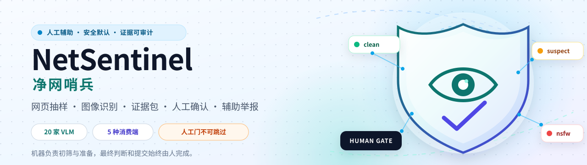
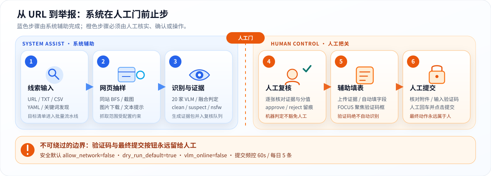
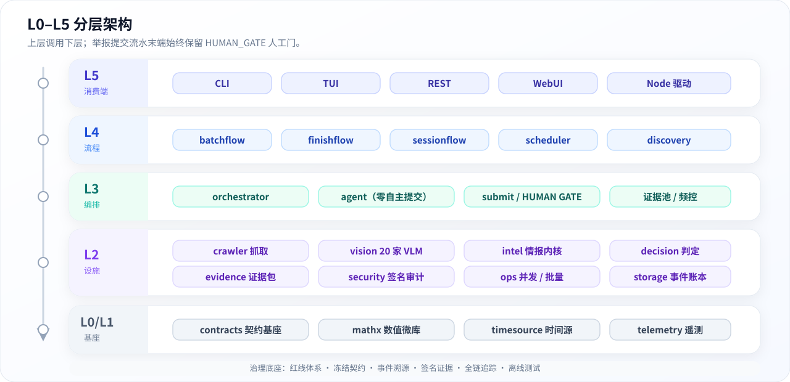
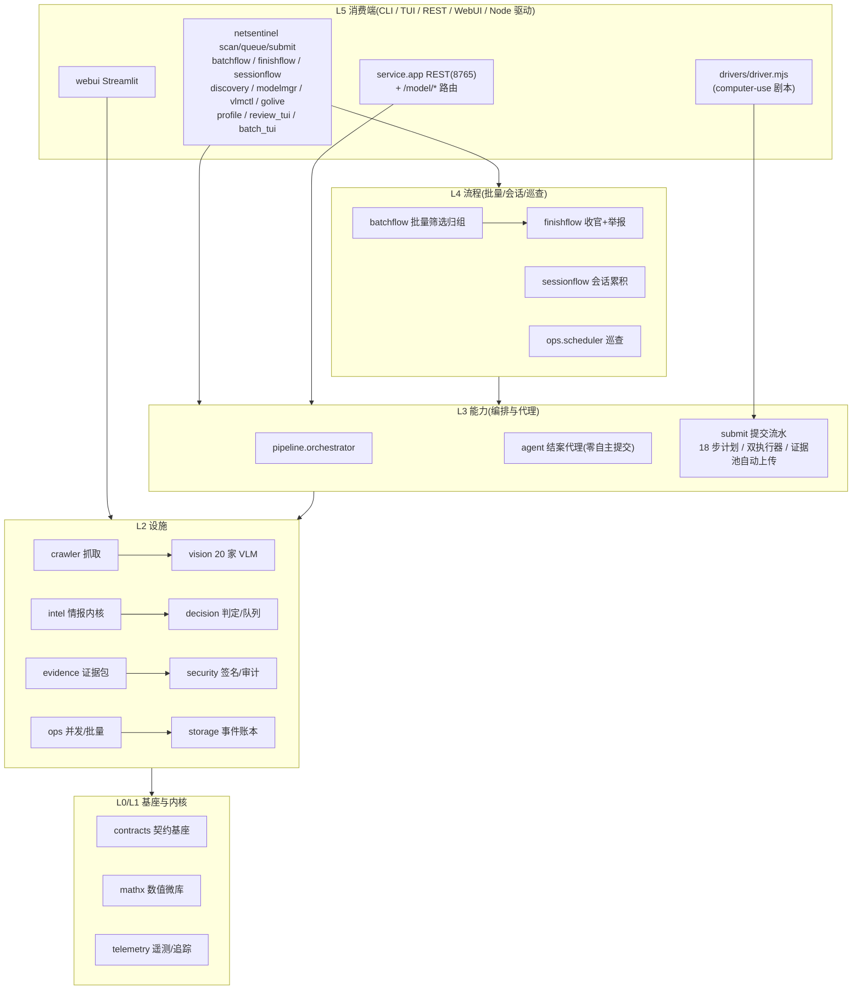

<div align="center">
  
</div>

<div align="center">
  
</div>

<p align="center">
  <strong>对运营者提供的 URL 做网页抽样与图像识别，生成证据包；经人工确认后，辅助填写官方举报表单。</strong><br/>
  举报渠道一：<code>www.12377.cn</code> —— 中央网信办违法和不良信息举报中心<br/>
  举报渠道二：<code>www.shdf.gov.cn</code> —— 全国“扫黄打非”工作小组办公室
</p>

<p align="center">
  <a href="#项目定位与使命">定位与红线</a> ·
  <a href="#工作流">工作流</a> ·
  <a href="#核心能力">核心能力</a> ·
  <a href="#运行入口速查">入口速查</a> ·
  <a href="#安装">安装</a> ·
  <a href="#快速开始">快速开始</a> ·
  <a href="#架构">架构</a> ·
  <a href="#文档索引">文档索引</a>
</p>

> [!NOTE]
> 本 README 的题图、状态条、流程图和架构图均为仓库内的**矢量 SVG**，不依赖外部图床，任意缩放都保持清晰。

## 项目定位与使命

> [!IMPORTANT]
> **NetSentinel 是辅助人工的“初筛 + 半自动举报”工具，不是无人值守机器人。**
> - 判定只有 `clean / suspect / nsfw` 三档，**非 clean 一律进入人工复核队列**；即使判为 `nsfw`（高置信），也必须经人工确认（`approve`）后才允许提交——机器判定不豁免人工。
> - 填表自动化在 `HUMAN_GATE`（人工门）步骤暂停：**验证码与最终提交按钮永远留给人工**，系统绝不自动识别或绕过验证码。
> - V10.16 起，人工门前会**自动上传证据截图**（每站 Top-10 池，按门户配额：12377 十张 / 扫黄打非五张）；人工门随即核对已传附件、输入验证码并最终确认。
> - 安全默认：`allow_network=false`（除回环外禁止真实联网）、`dry_run_default=true`（干跑，不真正驱动浏览器提交）、`vlm_online=false`（图像数据不出本机）；一切“真实动作”都需运营者显式开启。
> - 强制提交频控：两次提交最小间隔（默认 60s）与每日最大提交数（默认 5）不可绕过；批量模式频控不放宽。

完整红线见 [docs/ETHICS.md](docs/ETHICS.md) 与 [docs/REDLINES.md](docs/REDLINES.md)。红线编号累计至 53；38/39 经 `CONTRACTS-V18.md` 消歧为 38a/38b、39a/39b，实质红线共 55 条，V17 另有六条“全席共约”不续编号。

### 一眼看懂

| 维度 | NetSentinel 的边界 |
| --- | --- |
| 核心任务 | URL 抽样 → 图像识别 → 三档判定 → 证据包 → 人工复核 → 辅助填表 → 人工提交 |
| 机器职责 | 初筛、归组、生成证据与举报计划、自动填写非验证码字段、上传证据截图 |
| 人工职责 | 核对证据、批准或驳回、输入验证码、最终确认并提交 |
| 默认安全 | 禁止真实联网、默认干跑、VLM 默认离线、提交频控不可放宽 |
| 消费形态 | CLI、两个 TUI、REST、Streamlit WebUI、Node computer-use 驱动 |

## 工作流

<p align="center">
  
</p>

批量路线：`discovery`（找线索）→ `batchflow --input`（筛选归组）→ `cli.batch_tui`（逐组声明）→ `finishflow --report --exec` 或 `--precheck --exec`（逐条人工门依次举报）。详见 [docs/BATCH_GUIDE.md](docs/BATCH_GUIDE.md)。

## 核心能力

| 能力域 | 代表能力 | 结果 |
| --- | --- | --- |
| 识别与证据 | 单站 BFS 抽样、20 家 VLM、ensemble 融合、三档判定 | 截图、图片、manifest、summary 组成可复核证据包 |
| 情报与批量 | 感知哈希、站点关联图谱、三级归纳、搜索引擎线索发现 | 镜像变体与图片指纹团伙归组，支持断点续跑 |
| 提报与治理 | 人工门、证据池、理由生成、个人信息模板、签名与审计账本 | 半自动填表、逐条留痕、事件可重放、X-Trace-Id 全链追踪 |
| 性能与韧性 | 送审闸门、三档并发、流水线重叠、优雅退出、SPRT 实时早停门禁 | 降低无效调用，崩溃可续跑，增强内核需测量 + 人批 + 指纹三锁 |
| 多端消费 | CLI / TUI / REST / WebUI / Node 驱动 | 终端、浏览器与自动化集成都能使用同一套事实源 |

<details>
<summary><strong>展开完整演进清单（V2 → V10.38）</strong></summary>

- **单站初筛(v1)**:同 host BFS 链接发现 → 逐页截图/图片下载/文本提示 → 可插拔分类器(`stub`/`nudenet`/`clip`)→ ensemble 加权平均 → 契约化三档判定 → 证据包(截图+图片+manifest+summary)入审核队列。
- **多平台 VLM 识别(V2/V4/V8)**:20 家视觉提供方统一接入——16 家云端(glm/openai/anthropic/gemini/qwen/doubao/hunyuan/moonshot/minimax/stepfun/siliconflow/ernie/openrouter/groq/together/xai)+ 4 家本地(ollama/vllm/lmstudio/xinference);故障转移链、跨平台统一预算账、密钥环存储、自动接管(takeover)与连接向导(`http://127.0.0.1:8766/`)、`modelmgr`/`vlmctl` 管理命令。
- **情报内核(V3/V7/V16)**:感知哈希(phash 256bit + mirror/ring/pyramid 三不变哈希候选)近重复识别、站点关联图谱(增量并查集 + 团伙判定 connectivity/community)、URL/文本风险特征、案件组归纳与命名建议。
- **批量流水线(V6/V6.5)**:TXT/CSV/YAML 批量导入 → 并发扫描 → 三级归纳(canonical 域 → 镜像变体 → 图片指纹重叠团伙)→ 合并证据包 → TUI 逐组人工声明(留痕)→ 批量队列 → 顺序逐条提交(逐条人工门)→ HTML 结案报告;搜索引擎线索发现(discovery:Yandex XML / 自托管 SearXNG,关键词自定义)。
- **内核进化(V7)**:SPRT 序贯早停、Brier 可靠性加权融合、肤色概率图与 n-gram 文本内核、LSH 分带检索、浏览器会话复用、举报文风内核;全部默认关、零 API 破坏。
- **三档并发(V9)**:CPU 自适应 low/mid/high(psutil 可选采样降档);高档只压榨本地计算与回环 IO,**对外礼貌间隔/举报频控一概不放宽**(红线 35);结案代理(SummaryAgent/SequentialReportAgent)只做汇总与举报准备,无自主提交权(红线 36)。
- **举报体验(V10.x)**:举报理由自动生成(≤39 字,只基于已核实事实)、个人信息模板 `profile.yaml` 一次配置自动填入(掩码不进日志)、半自动焦点 FOCUS(光标自动聚焦验证码框)、批量预审 `--precheck`(一次确认全部就绪条目)、**证据截图人工门前自动上传(V10.16:每站 Top-10 池,12377 十张/shdf 五张)**。
- **可信与观测(V11–V16)**:证据包签名(HMAC-SHA256 / Ed25519 + 时间证明)、事件溯源账本(append-only + 离线重放对账)、分歧弃权(abstain 只提权不进判定)、X-Trace-Id 全链追踪与 `GET /trace/{job_id}`、审计 JSONL Merkle 树、AIMD 并发只收紧不放宽、会话累积(sessionflow 跨会话按网站名字累积/存档/续跑)。
- **性能与无人值守韧性(V10.28–V10.38)**:送审闸门(小图/重复/近重复拦下,调用 −63%)、受界并发送审(阶段 7.9×)、扫描预检(爬前拦系统性故障,盲打 −67%)、站内爬取/推理流水线重叠(慢站 1.25×)、标注集+校准门禁(Brier/ECE/三阈值混淆,SPRT 开启条件可复算)、**优雅退出**(Ctrl-C 停接新站→排空在飞→中文摘要,再按一次硬中断)、**站级断点续跑**(scan journal,崩溃重跑零重抓已完成站)、**遥测批末落盘**(`telemetry_jsonl_path` 时序台账)、**告警有界重试**(opt-in 指数退避,只重发通知绝不重发动作)、**服务池档位化**(REST 扫描池 2→10 路,与批量三档并发对齐)、**SPRT 实时早停 + 内核门禁执行器**(V10.38:三道锁=测量/批准/指纹,门禁未过响亮降级;激活后强 clean 站送审 −56%、判定逐项一致;`vlm_max_images_per_site` 首次成为真实站级上界)。
- **五种消费端形态**:CLI(10+ 入口)、TUI(复核/批量两个)、REST(service.app,默认 `127.0.0.1:8765`)、WebUI(Streamlit 复核台)、Node 驱动(computer-use 剧本,`drivers/driver.mjs`)。

</details>

## 运行入口速查

安装后主命令 `netsentinel`（等价 `python -m netsentinel`）提供 `scan/queue/submit`；其余入口以模块方式运行。各入口旗标以 `--help` 实际输出为准。

| 入口 | 命令 | 用途 |
| --- | --- | --- |
| 主 CLI | `netsentinel scan --url <URL>` | 单站扫描判定(非 clean 自动入队) |
| | `netsentinel queue list / show / approve / reject` | 人工复核队列 |
| | `netsentinel submit --id N --portal {12377,shdf} [--dry-run/--exec]` | 提交举报(人工门前自动上传证据截图) |
| 批量筛选 | `python -m netsentinel.batchflow --input 清单.txt` / `--resume 批次号 [--exec]` | 筛选→归组 / 续批(Ctrl-C 优雅排空;崩溃后 `--resume-scan 扫描批次号` 断点续跑) |
| 收官与举报 | `python -m netsentinel.finishflow --input 清单 [--tier low/mid/high]` | 批量收官汇总 |
| | `python -m netsentinel.finishflow --report [--resume N] [--exec]` | 举报准备(逐组声明+逐条人工门) |
| | `python -m netsentinel.finishflow --precheck --exec` | 批量预审(一次确认,逐条自动填写+聚焦验证码框) |
| 会话累积 | `python -m netsentinel.sessionflow --input/--url/--status/--report/--archive` | 跨会话按网站名字累积与确认举报 |
| 线索发现 | `python -m netsentinel.discovery --keywords-file 关键词.txt [--engine yandex/searxng/mock] --out leads.txt` | 搜索引擎线索(默认零外呼) |
| 复核 TUI | `python -m netsentinel.cli.review_tui [--four-eyes] [--event-ledger 路径]` | 交互式终端复核(含双人复核/事件账本) |
| 批量 TUI | `python -m netsentinel.cli.batch_tui` | 分组查看 / 逐组声明 / 批量预览 |
| 模型管理 | `python -m netsentinel.modelmgr status/probe/list/switch/test/takeover/serve` | 活动模型切换与连接向导(serve 默认端口 8766) |
| VLM 体检 | `python -m netsentinel.vision.vlmctl list/models/ping/doctor` | 提供方目录 / 连通性(ping 为唯一外呼命令) |
| 个人模板 | `python -m netsentinel.submit.profile setup/show/reset/path` | 举报人信息一次配置自动填入(掩码) |
| 上线体检 | `python -m netsentinel.golive check [--net] / prepare` | 离线体检 / 只读外网探活 / 生产配置模板 |
| 定期巡查 | `python -m netsentinel.ops.scheduler --loop --interval-min 360`(或 `--once`) | watchlist 周期巡查+站点记忆去重 |
| REST 服务 | `python -m service.app`(默认 `127.0.0.1:8765`,无鉴权仅本机) | HTTP 集成(端点见 docs/API.md) |
| WebUI | `streamlit run webui/app.py` | 浏览器复核台(仅本机;标注工作台 `webui/label_page.py` 8503,`start_services` 一键常驻五服务) |

环境变量 `NETSENTINEL_DATA_DIR`(V10.21 起全局生效:CLI/REST/WebUI 统一在 `load_config` 认,优先级 env > `config.yaml` > 默认 `./data`,空串视为未设)可把数据目录整体指向任意路径,详见 [docs/DEPLOY.md](docs/DEPLOY.md)。

## 安装

要求 Python 3.10+。

```bash
# 基础 + 浏览器 + nudenet 视觉 + 开发/测试
python -m pip install -e ".[browser,vision,dev]"

# Playwright 浏览器内核
python -m playwright install chromium

# 可选 extras(全部惰性导入,缺失不阻断,按需安装):
#   clip      —— CLIP 分类器(transformers + torch,体积较大)
#   ui        —— Streamlit 复核台
#   api       —— REST 服务(fastapi + uvicorn)
#   fast      —— numpy 加速(mathx 热路径)
#   analytics —— pyarrow(批分析)
#   system    —— psutil(CPU 占用采样降档)+ keyring(OS 密钥环)
python -m pip install -e ".[system]"
```

说明:仅剩基础依赖(PyYAML)时,`stub` 分类器与全部 CLI 仍可用;所有可选三方库缺失时给出带安装提示的中文错误。

## 快速开始

```bash
# 1) 复制配置模板,按需修改
cp config.example.yaml config.yaml
#    编辑 config.yaml:将 allow_network 改为 true(默认 false,安全默认,请显式开启)

# 2) 扫描目标站点(抽样 + 识别 + 判定)
netsentinel scan --url "https://待核查站点.example/" --config config.yaml
#    判定为 suspect/nsfw 时:自动生成证据包并入审核队列,终端给出队列 id

# 3) 人工复核(先看证据包里的截图与 Top10 图片分值表,再决定)
netsentinel queue list
netsentinel queue approve --id 1

# 4) 提交举报(先干跑看步骤,再真实执行)
netsentinel submit --id 1 --portal 12377 --dry-run
netsentinel submit --id 1 --portal shdf --exec
#    真实执行:自动填写表单+个人信息 → 自动上传证据截图(12377 十张/shdf 五张)
#    → FOCUS 聚焦验证码框 → HUMAN_GATE:人工核对附件 → 输入验证码 → 回车 → 自动点击提交
```

## 架构

<p align="center">
  
</p>

> 完整分层说明(L0–L5)、模块职责表与数据流时序见 [docs/ARCHITECTURE.md](docs/ARCHITECTURE.md);CLI 完整参数、18 步标准序列与 SELECTORS 13 键见 [docs/USAGE.md](docs/USAGE.md)。

<details>
<summary><strong>查看 Mermaid 架构源码图</strong></summary>



</details>

<details>
<summary><strong>展开完整目录结构</strong></summary>

```text
netsentinel/                 # Python 包
  contracts.py               # 契约基座:全部数据结构与 Config(禁改,被 88 处 import)
  config.py / logging_util.py / atomic.py / sessionstore.py
                             # 配置装载校验 / 日志与 JSONL 审计 / 原子写 / 会话存档
  mathx.py                   # 数值微库(零内部依赖,可选 numpy 加速)
  telemetry.py / telemetry_export.py / telemetry_trace.py
                             # 遥测计数计时(只存名称与数字) / Prometheus 导出 / 全链追踪
  crawler/                   # 抓取:fetcher(HTTP+禁网闸门) browser(抽样+会话复用) site_map(BFS)
  vision/                    # 识别:20 家 VLM 提供方 / vlm_client / 缓存预算 / ensemble / vlmctl
  intel/                     # 情报内核:phash 近重复 / canonical 域归并 / graph 图谱团伙 / 文本风险
  decision/                  # 判定 verdict / 复核队列 review_queue / 融合仲裁
  evidence/                  # 证据包构建(manifest+summary+zip)
  submit/                    # 提交流水:form_models(13 键选择器+18 步计划) / 双门户 planner /
                             #   双执行器 / rate_limit / evidence_pool(V10.16) / reason_gen / profile
  pipeline/                  # 编排收口 orchestrator(scan/submit 主流程)
  agent/                     # 结案代理:summary_agent 汇总 / sequential_report 依次举报(零自主提交)
  batchflow.py / finishflow.py / sessionflow.py
                             # 批量筛选 / 收官+举报准备+批量预审 / 会话累积 三大流程 CLI
  discovery/                 # 搜索引擎线索发现(yandex/searxng/keywords/pipeline)
  ops/                       # 运营:bulk_intake 批量导入 / batch_scan / concurrency 三档并发 /
                             #   scheduler 巡查 / cpu_profile / aimd / audit_verify
  security/                  # 密钥环 keys / vault 脱敏+审计哈希链 / bundle_sign 签名 / merkle
  storage/                   # 事件账本 event_log(append-only) / replay 重放对账
  service/                   # REST:app.py(FastAPI 工厂) / model_api(/model/* 路由)
  setup/                     # 连接向导(纯标准库自托管单页,端口 8766)
  cli/                       # review_tui 复核 TUI / batch_tui 批量声明 TUI
  modelmgr.py / golive.py    # 模型管理 CLI / 上线体检与生产配置模板
  policy/ / report/ / notify/ # 政策引擎 / HTML 报告 / webhook 通知
  __main__.py                # 主 CLI:scan / queue / submit
service/app.py               # REST 服务入口(uvicorn)
webui/                       # Streamlit 复核台(队列/分组/模型/提供方/仪表盘/草稿流)
drivers/driver.mjs           # computer-use 剧本驱动(Node)
portals/                     # 门户定义(12377.yaml / shdf.yaml,动态门户需显式 enabled)
tests/                       # 离线、零外呼、mock 门户的测试套件
benchmarks/                  # kernel_bench 内核自检 / 语料与基准
scripts/                     # 离线演示脚本(demo_stub_scan 等)
docs/                        # 使用指南、架构、契约说明与法规语料(索引见 docs/INDEX.md)
config.example.yaml / watchlist.example.yaml / profile.yaml.example
                             # 配置模板(真实 config.yaml/profile.yaml/watchlist.yaml/keywords.txt 已 gitignore)
CONTRACTS.md + CONTRACTS-V2.md … CONTRACTS-V18.md
                             # 增量冻结契约与 V18 勘误追认(红线编号 1–53)
CHANGELOG.md                 # 迭代总账(V1.0 → V10.38)
```

</details>

## 文档索引

完整文档分类索引(基础 / 指南 / 提供方 / 运营 / 升级记录 / 门户调研 / 法规)见 **[docs/INDEX.md](docs/INDEX.md)**;常用入口:

- [docs/USAGE.md](docs/USAGE.md) —— CLI 完整参考、队列状态机、18 步标准序列、SELECTORS 13 键、Config 分组
- [docs/ETHICS.md](docs/ETHICS.md) —— 使用红线与法律提示(必读)
- [docs/REDLINES.md](docs/REDLINES.md) —— 编号红线总表(含 38/39 重号消歧说明)
- [docs/ARCHITECTURE.md](docs/ARCHITECTURE.md) —— L0–L5 分层架构、模块职责、数据流
- [docs/API.md](docs/API.md) —— REST 端点(含 /model/* 与 /trace)
- [docs/DEPLOY.md](docs/DEPLOY.md) —— 部署、自启、容器、审计校验

## 契约体系

并行开发以**冻结契约系列**为唯一依据:`CONTRACTS.md`(v1 主契约,红线 1–5)起,增量追加 `CONTRACTS-V2.md` … `CONTRACTS-V18.md`(V18 为勘误与追认契约,不改动主契约与 `contracts.py`)。红线编号累计至 53;V6.5 的 27/28 与 V9.1/V10.0 的 38/39 记账于 CHANGELOG,38/39 的 A/B 面重号经 V18 定名 38a/38b、39a/39b,梳理见 [docs/REDLINES.md](docs/REDLINES.md)。`netsentinel/contracts.py` 是数据结构唯一事实源(禁改);`tests/test_contracts_sync.py` 对契约文档与代码做机器对账;`pyproject.toml` 的 importlinter 配置声明主干分层契约(`lint-imports` 执行)。

## 测试

```bash
python -m pytest tests/ -q    # 全离线、零外呼、零真实门户
```

## 路线图

- 真实门户选择器核验:上线前人工核验 www.12377.cn / www.shdf.gov.cn 真实表单与 `SELECTORS`(当前以本地 mock 对齐)。
- 模型与阈值优化:ensemble 成员扩充、误报/漏报评估。
- 报表:基于审计日志与事件账本的扫描/复核/提交统计。

## 许可与责任

本工具仅用于合法的违法不良信息举报辅助。使用者须遵守 [docs/ETHICS.md](docs/ETHICS.md) 的全部红线;对每一条举报的真实性,由**人工核实并最终确认的操作者本人**负责。
