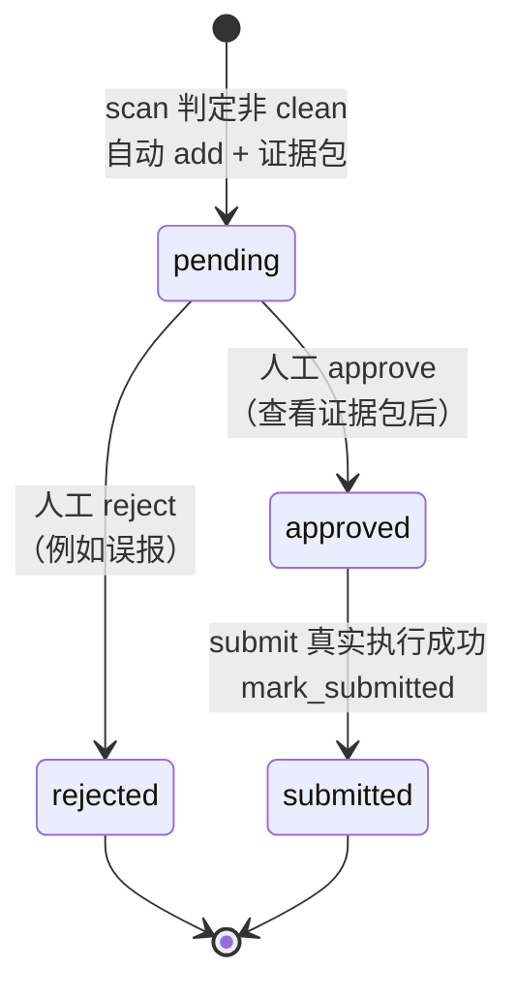

# NetSentinel 使用手册(USAGE)

本手册覆盖全部 CLI 入口、审核队列工作流、证据包结构、SELECTORS、18 步标准序列、Config 分组概览与常见问题。所有行为以 `CONTRACTS.md` 系列(17 份)与 `netsentinel/contracts.py` 为准;各子命令的具体旗标以 `--help` 实际输出为准。

入口总览:主命令 `netsentinel`(等价 `python -m netsentinel`)提供 `scan / queue / submit` 三个子命令;其余功能入口以模块方式运行(速查表见下文 §1)。CLI 启动时先完成日志初始化(`setup_logging`),运行日志写入 `log_path`(默认 `data/logs/netsentinel.log`);首次运行会触发自动接管(`takeover_once`:探测本地视觉服务/云密钥,无模型时弹出连接向导,失败只告警不阻断)。

---

## 1. 全部 CLI 入口速查

| 入口 | 命令 | 用途(常用参数) |
| --- | --- | --- |
| 单站扫描 | `netsentinel scan --url <URL> [--config PATH] [--verbose]` | 抽样+识别+判定,非 clean 自动入队 |
| 复核队列 | `netsentinel queue <list/show/approve/reject> [参数]` | 人工复核(参数转交 review_queue) |
| 提交举报 | `netsentinel submit --id N --portal {12377,shdf} [--dry-run/--exec]` | 人工门前自动上传证据截图 |
| 批量筛选 | `python -m netsentinel.batchflow --input 清单 [--config] [--resume 批次号 [--exec]] [--resume-scan 扫描批次号]` | 筛选→归组(不提交) / 续批 / 扫描断点续跑 |
| 收官汇总 | `python -m netsentinel.finishflow --input 清单 [--tier low/mid/high]` | 批量扫描收官汇总(不提交) |
| 举报准备 | `python -m netsentinel.finishflow --report [--resume N] [--exec]` | 就绪清单→依次举报(逐条人工门) |
| 批量预审 | `python -m netsentinel.finishflow --precheck [--exec]` | 一次确认全部就绪条目,逐条自动填写+聚焦验证码框 |
| 会话累积 | `python -m netsentinel.sessionflow --input/--url/--status/--report/--archive`(五选一) | 跨会话按网站名字累积/存档/确认举报 |
| 线索发现 | `python -m netsentinel.discovery --keywords-file 词表.txt [--engine yandex/yandex-html/searxng/mock] [--transport browser/http] [--keywords 内联] [--template 模板] [--out leads.txt] [--offline-check]` | 搜索引擎线索(默认零外呼);`--keywords-file` 建议指向 `<data>/keywords/active.txt`(关键词工作台维护的活文件,见"关键词工作台"行) |
| 复核 TUI | `python -m netsentinel.cli.review_tui [--db PATH] [--four-eyes] [--event-ledger PATH]` | 交互式终端复核(纯标准库;含双人复核与事件账本双写) |
| 批量 TUI | `python -m netsentinel.cli.batch_tui [--db PATH] [--config PATH]` | 分组查看/逐组声明(留痕)/批量队列预览,绝不真实提交 |
| 模型管理 | `python -m netsentinel.modelmgr status / probe / list [提供方] / switch 规格 [--force] / test [规格] / takeover / serve [--port]` | 活动模型切换;serve 启动连接向导(缺省 `setup_port` 8766) |
| VLM 体检 | `python -m netsentinel.vision.vlmctl list / models 提供方 / ping 规格 [--image 图] [--offline] / doctor [--probe]` | 提供方总表/模型目录/连通性;ping 是唯一外呼命令,须人工显式执行 |
| 个人模板 | `python -m netsentinel.submit.profile setup / show / reset / path` | 举报人信息一次配置(优先级:传参>env>profile.yaml>config;掩码不进日志) |
| 上线体检 | `python -m netsentinel.golive check [--net] [--json PATH] / prepare` | 离线体检;`--net` 只读外网探活(GET 首页取样 512B);prepare 生成生产配置模板 |
| 定期巡查 | `python -m netsentinel.ops.scheduler --once / --loop [--interval-min 分钟]` | watchlist 周期巡查+站点记忆去重+待复核通知 |
| REST 服务 | `python -m service.app` | 默认 `127.0.0.1:8765`,无鉴权仅本机(端点见 [API.md](API.md)) |
| **服务保活** | `python scripts/start_services.py [status] [--with-demo]` | 一键拉起/体检净网助手骨架(REST 8765 + 助手页 8500 + 复核台 8501 + 关键词页 8502;已在线自动跳过,无窗口启动;status 只读) |
| WebUI | `streamlit run webui/app.py` | 浏览器复核台(仅本机) |
| 关键词工作台 | `streamlit run webui/keywords_page.py` | 发现搜索词实时编辑/词组库一键切换(`<data>/keywords/`,纯本地零外呼;保存后下次发现运行即生效) |
| 净网助手 | `streamlit run webui/assistant_page.py` | 发现→扫描→复核一站式控制台(所有操作经本机 REST `127.0.0.1:8765` 后台执行,页面只手动轮询展示;唯一弹窗 = 显式点击的验证会话窗口;须先 `python -m service.app`) |
| 标注工作台 | `streamlit run webui/label_page.py`(8503) | 校准标注集人工标注:看图点击 clean/nsfw 即时原子落盘(`human:webui` 溯源),门禁 C1(正/负样本 ≥20)实时进度,补充语料(pending)与**整组导入正/负样本目录**(`human:dir-import`,确认门+已标绝不覆盖)双入口,改标纠错;零模型调用,与 CLI `calibration label`/`import` 读写同一 JSONL |
| 全入口体检 | `python scripts/entry_check.py [--list] [--only 子串] [--json 报告.json]` | 本表全部入口 + WebUI 9 页导入层的离线功能体检(隔离沙箱+临时本地静态服务,见 §1.7) |

另有低频维护入口:`python -m netsentinel.storage.replay`(事件账本重放对账)、`python -m netsentinel.ops.audit_verify`(审计哈希链校验)、`python -m netsentinel.submit.form_scanner`(门户表单扫描出 YAML 草稿,绝不自动生效)。

### 1.1 `netsentinel scan` —— 扫描判定

| 参数 | 必填 | 说明 |
| --- | --- | --- |
| `--url <URL>` | 是 | 待核查站点起点 URL |
| `--config <PATH>` | 否 | 配置文件路径;默认查找 `./config.yaml`(放在子命令之前) |
| `--verbose` | 否 | DEBUG 级日志 |

行为(编排契约):`discover_links` 同 host BFS(≤ `max_pages`)→ 逐页 `capture_page`(截图+图片+文本提示)→ `ensemble_members` 各分类器 `classify_batch` → `ensemble_scores` 加权 → `assess` 三档判定;`needs_review`(非 clean)时自动 `build_bundle` 生成证据包并 `queue.add` 入队,同时写审计日志。

识别失败的诚信语义(V10.24,默认开启):有图片评分失败(静默缺评或 `scores["error"]` 错误分)时,**"未见违规"≠"识别做成"**——verdict 三档保持原判定不动,但 `needs_review` 强制置真、入列备注追加 `[识别失败 N 张,判定置信受损]`,verdict=clean 时 CLI 与日志各输出一行醒目中文警示(可用 `escalate_on_classify_error: false` 附加配置关闭回旧行为)。若首笔批量评分**全部失败且张数 ≥ 5**(如密钥余额耗尽),扫描直接熔断报错并提示 `python -m netsentinel.vision.vlmctl ping 规格` 诊断,不再对其余图片盲打(阈值经 `classify_abort_threshold` 附加属性可调)。

结果解读:`agg_nsw_prob` 为达标图片集合的最高集成分,`nsw_image_count` 为单图分 ≥ `prob_count_line` 的达标图数量;**`nsfw` 同样必须人工确认后才允许提交**。

### 1.2 `netsentinel queue` —— 审核队列

管理 sqlite 审核队列(库 `db_path`,默认 `data/review_queue.db`),中文输出。

| 子动作 | 参数 | 说明 |
| --- | --- | --- |
| `list` | 可选状态过滤 | 列出条目;状态 `pending / approved / rejected / submitted` |
| `show` | `--id <ID>` | 单条详情(判定、证据包路径、备注、时间戳) |
| `approve` | `--id <ID>`(可附备注) | 人工批准(复核证据包之后!) |
| `reject` | `--id <ID>`(可附备注) | 人工否决(例如复核后认定误报) |

### 1.3 `netsentinel submit` —— 提交举报

| 参数 | 必填 | 说明 |
| --- | --- | --- |
| `--id <ID>` | 是 | 队列条目 id,状态必须 `approved` |
| `--portal {12377,shdf}` | 是 | 举报渠道 |
| `--dry-run` / `--exec` | 否 | 二选一;缺省跟随 `dry_run_default`(默认 `true`) |

不存在 `--yes` 之类自动确认参数:`auto_confirm` 在 CLI 层恒为 `False`,人工门由执行器在真实执行时交互落实。

两门户差异:

| | 12377 | shdf |
| --- | --- | --- |
| 入口 | `portal_12377_base`(默认 https://www.12377.cn ) | `portal_shdf_base`(默认 https://www.shdf.gov.cn ) |
| 信息类型 | 色情低俗信息 | 淫秽色情类 |
| 证据截图自动上传配额(V10.16) | 10 张 | 5 张 |

### 1.4 批量三入口(batchflow / finishflow / sessionflow)

- **`batchflow --input 清单`**(筛选流程):TXT/CSV/YAML 加载 → 规划 → 扫描 → 归组 → 摘要,**恒不提交**;结束后提示下一步用 `batch_tui` 声明。`--resume 批次号` 续批(默认干跑;真实执行须显式 `--exec`,仅续批模式有效)。
  - **优雅退出(V10.35)**:扫描中按一次 Ctrl-C / SIGTERM → 停止提交新站,**已在飞的站排空完成后**正常收场(摘要打印 `⚠ 优雅退出` 与未提交数,绝不半途弃单);再按一次 → 立即硬中断(中文提示后退出码 0)。`graceful_exit_enabled: false` 可关回旧行为。
  - **断点续跑(V10.35)**:每站结局自动落 `data/scan_journal.db`(只记 URL 与 done/failed 枚值);摘要打印本批 `扫描批次` 号;批量中途崩溃(断电/杀进程/硬中断)后,同清单加 `--resume-scan 扫描批次号` 重跑——**已完成的站直接跳过,零重抓**(在飞站重扫,VLM 结果由缓存幂等兜底);失败站默认重试。`scan_journal_enabled: false` 可关。
- **`finishflow --input 清单`**(收官流程):档位(`--tier` 覆盖 `concurrency_tier`)→ 扫描 → SummaryAgent 结案汇总(HTML 报告),**恒不提交**;`--report` 举报准备(默认干跑,`--exec` 真实执行,内部仍是逐组声明+逐条人工门);`--precheck` 批量预审(一次确认全部就绪条目,逐条自动填写+FOCUS 聚焦验证码框,你只需在浏览器输入验证码+回终端回车);`--resume` 仅 `--report` 模式有效。
- **`sessionflow`**(会话累积,五选一):`--input`/`--url` 扫描并按网站名字累积(永不提交);`--status` 查看累积现状;`--report [--reviewer 名字] [--exec]` 确认举报全部累积结果;`--archive` 立即存档。

三入口的退出码约定:0 成功;2 用法/配置/清单错误;3 兄弟模块未就位(RuntimeError,中文消息)。

### 1.5 `modelmgr` 与连接向导

`python -m netsentinel.modelmgr` 子命令:`status`(活动模型/云密钥布尔/本地服务一行摘要)、`probe`(探测本机回环视觉服务,仅 127.0.0.1,红线 32)、`list [提供方]`(模型目录,含本地扫描发现)、`switch 规格`(如 `ollama:llava`、`glm:glm-4.5v`;默认先连通性测试,`--force` 跳过)、`test [规格]`、`takeover`(手动触发自动接管)、`serve [--port]`(启动连接向导,缺省端口 `cfg.setup_port`=8766,被占自动 +1..+5)。

### 1.6 `vlmctl`(VLM 体检)

`python -m netsentinel.vision.vlmctl`:`list` 提供方总表(零外呼)/ `models 提供方` 模型目录(零外呼)/ `ping 提供方[:模型]`(唯一外呼命令,人工显式执行,可 `--image` 送审图、`--offline` 仅查配置)/ `doctor [--probe]` 全提供方配置体检(默认零外呼)。

### 1.7 全入口体检器(`scripts/entry_check.py`)

`golive check` 管配置,本工具管**功能**:把 §1 全部 CLI 入口与 WebUI 9 页导入层(共 28 条 curated 清单)逐条以子进程跑离线最小命令——扫描类条目由体检器自起的临时本地静态服务(随机端口伺服 `tests/fixtures/demo_site`)供页,TUI 类条目喂 stdin 命令脚本,`--help` 类条目只验参数面。

命令:`python scripts/entry_check.py` 跑全量;`--list` 只列清单;`--only 子串` 按名称过滤(可多次,并集);`--json 路径` 附加导出机器报告;单条默认超时 120s(扫描类 240s)。退出码:0=全部通过 / 1=有失败条目 / 2=体检器自身用法错误(与项目门禁语义一致)。

红线:零真实外呼(仅触 127.0.0.1)/ 不改真实 `data/`(每次运行用临时沙箱作 `NETSENTINEL_DATA_DIR`,隔离配置关闭 `takeover_auto` 等危险开关)/ 不启动常驻服务(唯一监听是体检器自己的临时静态服务,跑完即关)。历史差异(本波已修复并回归):个人模板实际模块为 `python -m netsentinel.submit.profile`(入口表已更正);`service.app` 的 `main()` 现已支持 `--host/--port/--help` 参数解析。

---

## 2. 审核队列状态机

原则:**机器只初筛,人来拍板**。任何条目不经人工 `approve` 都无法提交;`nsfw` 也不例外。



- 提交前置校验:条目必须 `approved`;`RateLimiter.can_submit()` 频控(间隔 ≥ `submit_min_interval_s` 且当日 < `submit_max_per_day`)。
- 批量模式:`batch_item_interval_s ≥ submit_min_interval_s`(config 强制校验,红线 26);额度用尽自动挂起,`--resume` 续批。
- 每条 `Entry`:`id / site_url / verdict / status / evidence_zip / created_at / updated_at / note`;V6 批量流程的组条目带 `[组:名]` 标记。
- 事件账本(可选):`review_tui --event-ledger 路径` 后,approve/reject/双人确认**先账本后状态**双写,可离线重放对账(`python -m netsentinel.storage.replay`)。

---

## 3. 证据包结构

证据包由 `evidence.packager.build_bundle` 生成,目录形如 `<evidence_dir>/<safe_host>_<时间戳>/`(默认 `data/evidence/`):

```
<safe_host>_<ts>/
├── <页面整屏截图>.png        # 各抽样页面截图
├── <下载的受检图片>…          # sha256 已校验落盘的图片
├── manifest.json             # 站点报告全文 + 文件清单(每文件含 sha256)
├── summary.md                # 中文摘要(Top10 图片分值表)
├── evidence_pool.json        # V10.16:Top-10 证据截图预留清单(幂等重算)
└── …                         # 同目录内容打包为 .zip
```

- **manifest.json**:`SiteReport.as_dict()` 全文 + 文件清单,供追溯与防篡改核对。
- **summary.md**:人工复核第一入口(Top10 高分图分值表)。
- **evidence_pool.json**(V10.16):按 ensemble `nsfw_prob` 降序的 Top-10 现存图片(不足用整页截图补足),提交前由执行器按门户配额自动上传(12377 十张 / shdf 五张)。

人工复核要点:看 Top10 高分图是否确属色情内容;核对 `text_hint_hits` 与页面截图相互印证;警惕图标/广告图误报(小于 `min_image_px` 的图已自动剔除)。

---

## 4. SELECTORS(13 键)与 18 步标准序列

### 4.1 SELECTORS(`submit/form_models.py`,冻结常量,禁改)

```python
SELECTORS = {
    "url":      "#report-url",      # 举报链接
    "type":     "#report-type",     # 信息类型 select
    "desc":     "#report-desc",     # 具体描述 textarea
    "name":     "#report-name",     # 举报人姓名
    "phone":    "#report-phone",    # 举报人电话
    "email":    "#report-email",    # 电子邮箱(V10.2)
    "id":       "#report-idcard",   # 身份证号(V10.2)
    "address":  "#report-address",  # 通讯地址(V10.2)
    "postcode": "#report-postcode", # 邮政编码(V10.2)
    "org":      "#report-org",      # 单位名称(V10.2)
    "file":     "#report-file",     # 附件(证据截图自动上传口)
    "captcha":  "#report-captcha",  # 验证码 —— 只允许人工输入
    "submit":   "#report-submit",   # 提交按钮
}
```

SELECTORS 是不可变映射(原地修改立即 TypeError);本地 mock 表单与两个门户 planner 共用同一份(单一事实来源)。

### 4.2 18 步标准序列(`build_plan` 生成,顺序固定)

```
 1. goto(举报入口)
 2. wait(1s, 等待页面加载)
 3. select(信息类型 = category)
 4. fill(举报链接)                  # #report-url
 5. fill(具体描述)                  # #report-desc
 6. fill(举报人姓名)                # #report-name   空值 skippable
 7. fill(举报人电话)                # #report-phone  空值 skippable
 8. fill(电子邮箱)                  # #report-email  V10.2,空值 skippable
 9. fill(身份证号)                  # #report-idcard V10.2,空值 skippable
10. fill(通讯地址)                  # #report-address V10.2,空值 skippable
11. fill(邮政编码)                  # #report-postcode V10.2,空值 skippable
12. fill(单位名称)                  # #report-org    V10.2,空值 skippable
13. screenshot(填写完成后截图)
14. focus(验证码输入框)             # #report-captcha V10.1 半自动焦点:仅聚焦不填写
15. HUMAN_GATE(人工核对附件与已填信息 → 输入验证码 → 回终端回车)
16. click(提交按钮)                 # #report-submit
17. wait(2s, 等待提交处理)
18. screenshot(提交结果截图)
```

- 步骤 6–12 的个人信息由 `profile.yaml` 模板自动填入(V10;优先级:传参 > 环境变量 > `~/.netsentinel/profile.yaml` > `./profile.yaml` > config;`python -m netsentinel.submit.profile setup` 一次配置)。
- **证据截图自动上传(V10.16)不是步骤**:执行器在到达 `HUMAN_GATE`(第 15 步)之前把 Top-10 池按门户配额 `set_input_files` 到 `#report-file`;失败只记 notes 降级为人工门手动上传,绝不中断。
- `wait` 步可经 `meta["wait_until"]` 声明事件驱动等待条件(V10);缺省路径行为不变。
- 计划中**不存在任何自动填写验证码的步骤**;验证码别名拒绝逻辑对候选链逐候选生效(红线 42)。

---

## 5. Config 分组概览(`contracts.py::Config`,键与字段一一对应)

配置模板 `config.example.yaml`;未知键告警并忽略;字段按落地版本分组注释切分(`tests/test_contracts_sync.py` 以此对账)。安全默认:`allow_network=false`、`dry_run_default=true`、`vlm_online=false`、`discovery_online=false`。

| 分组(版本) | 代表键 | 说明 |
| --- | --- | --- |
| 判定阈值 | `nsfw_threshold(0.90) / review_threshold(0.50) / prob_count_line(0.80) / min_nsw_images(3) / min_image_px(200)` | 三档判定公式参数 |
| 抓取预算 | `max_pages(5) / max_images_per_page(12) / max_image_mb(8) / fetch_timeout_s(15) / fetch_delay_s(1.0) / respect_robots(true) / allow_network(false)` | 抓取样貌与禁网闸门 |
| 分类器 | `classifier(stub) / ensemble_members([stub])` | 主分类器与集成成员 |
| 提交安全 | `human_gate_required(true,不可关) / dry_run_default(true) / submit_min_interval_s(60) / submit_max_per_day(5)` | 红线落点 |
| 举报门户 | `portal_12377_base / portal_shdf_base` | 两门户入口 |
| 路径 | `data_dir / evidence_dir / db_path / audit_path / log_path` | 全部落盘位置 |
| V2:GLM 接入 | `glm_api_key / glm_base_url / glm_model(glm-5.3-flash) / glm_models_fallback / vlm_online(false) / vlm_max_images_per_site(8) / vlm_cache_db / vlm_daily_budget(200)` | VLM 外呼与预算 |
| V2:平台扩展 | `capture_engine(v1/v2) / use_fusion / notify_webhook / watchlist_path / service_host(127.0.0.1) / service_port(8765)` | 采集引擎/通知/服务 |
| V3:智能体 | `case_agent_model / vlm_cascade / vlm_escalate_above/below / phash_db / graph_db / four_eyes_required / policy_path / redirect_max_hops / video_max_frames / conformal_target_precision / adaptive_base_interval_h` | 级联/四眼/共形/图谱 |
| V4:全平台 VLM | `vlm_provider(glm) / vlm_api_keys / vlm_provider_base_urls / vlm_provider_models / vlm_fallback_chain / vlm_request_timeout_s / vlm_max_image_mb` | 20 家提供方接入面 |
| V6:大批量 | `group_merge_phash_overlap(0.3) / group_merge_template(true) / batch_max_items(20) / batch_item_interval_s(90) / batch_require_attestation(true)` | 批量与组归并 |
| V6.5:线索发现 | `discovery_online(false) / discovery_engine(yandex) / discovery_max_per_query / discovery_max_total / discovery_query_delay_s / discovery_cache_db / discovery_cache_ttl_h / yandex_xml_user / yandex_xml_key / searxng_base_url` | 搜索引擎发现(默认零外呼) |
| V7:内核进化 | `use_sprt / sprt_alpha / sprt_beta / use_reliability_fusion / phash_lsh_bands / browser_session_reuse(true) / sched_priority` | 全部默认关(除会话复用) |
| V8:插件/接管 | `plugin_supervised_api(true) / onboarding_auto_open(true) / agents_max_workers(4) / agent_task_db / takeover_auto(true) / local_probe_ports / setup_port(8766) / model_runtime_path` | 自动接管与连接向导 |
| V9:三档并发 | `concurrency_tier(mid) / concurrency_auto(false) / cpu_reserve(1) / summary_agent_enabled(true)` | CPU 自适应并发 |
| V10:个人信息 | `reporter_name / reporter_phone / reporter_email / reporter_id / reporter_address / reporter_postcode / reporter_type / reporter_org / profile_path` | 举报人模板(只进表单不进日志) |
| V11:正式收录 | `graph_wire / gang_mode(connectivity) / gang_weight_threshold / gang_template_weight_factor / gang_resolution / ensemble_reliability_weights / cascade_risk_budget / abstain_threshold(0.35) / bundle_sign_algo(hmac-sha256) / ed25519_seed_hex / tsa_url` | 图谱通电/团伙/签名 |
| V12:接线收口 | `trace_enabled(false) / abstain_enabled(false)` | 全链追踪/弃权(默认关且不触判定) |
| V13:收录残余 | `dynamic_ttl(false) / phash_mt_lsh_db / guard_model_path / guard_family` | 动态 TTL/多表 LSH/守卫模型 |
| V14:贝叶斯 | `bayes_reliability(false) / bayes_half_life(None)` | 可靠性回流(默认关) |

配置校验规则(违反抛中文 `ValueError`):`0 < review_threshold <= nsfw_threshold <= 1`;`prob_count_line <= nsfw_threshold`;`submit_min_interval_s >= 30`;`1 <= submit_max_per_day <= 20`;`max_pages >= 1`;`batch_item_interval_s >= submit_min_interval_s`。

---

## 6. 常见问题(FAQ)

### 6.1 提示 Playwright 浏览器未安装

```bash
python -m playwright install chromium
```

未安装 playwright 包时,`capture_page` 自动退化为仅抓 HTML 解析图片链接(无整页截图),扫描仍可进行。

### 6.2 提示 nudenet / transformers 未安装

```bash
python -m pip install -e ".[vision]"     # NudeNet
python -m pip install -e ".[clip]"       # CLIP
```

或改用离线 stub:配置 `classifier: stub`(仅按文件名规则打分,开发/测试专用)。VLM 识别走 20 家提供方(见 [PROVIDERS.md](PROVIDERS.md)),密钥经 `python -m netsentinel.vision.vlmctl doctor` 体检。

### 6.3 访问外网被拒(`NetworkDisabledError`)

安全默认:`allow_network=false` 时除 `127.0.0.0/8` 回环段外一律拒绝。确需扫描外部站点,由运营者在 `config.yaml` 显式 `allow_network: true`;图像出境另须 `vlm_online: true`(红线 6)。

### 6.4 提交被频控拦截

`RateLimiter` 返回失败与原因:距上次提交不足 `submit_min_interval_s`(默认 60s),或当日已达 `submit_max_per_day`(默认 5)。批量模式额度用尽自动挂起,`--resume` 续批。频控是红线(5/26),不要试图绕过。

### 6.5 `--dry-run` 与真实执行的差异

| | dry_run | 真实执行(--exec) |
| --- | --- | --- |
| 浏览器 | 不启动 | 启动(默认 headless) |
| 步骤 | 逐 Step 记 notes,`ok=True` | 真实 goto/select/fill/click,每步截图 |
| 证据截图上传 | 命中池时预演提示 | `HUMAN_GATE` 前自动按门户配额上传(V10.16) |
| HUMAN_GATE | 记"干跑跳过" | `input()` 交互等待人工确认 |
| 结果 | `submitted=False` | 成功则 `submitted=True`,队列 `mark_submitted` |

### 6.6 HUMAN_GATE 暂停时,操作员该做什么

真实执行到人工门会停下等待,此时完成三件事再回车继续:

1. **核对**屏幕/截图中已填信息与**已自动上传的证据截图**(12377 十张 / shdf 五张;附件不齐或上传失败时手动补传 `#report-file`);
2. **输入验证码**:光标已由 FOCUS 步骤聚焦在 `#report-captcha`,直接在浏览器打字——系统绝不自动识别或代填;
3. 回终端按回车,系统继续执行 `click(提交)` 并截图存档提交结果。

测试环境可用 `auto_confirm=True`(记录"自动确认(测试)"),仅限本地 mock,**严禁用于真实门户**。

### 6.7 `submit` 报"条目状态不是 approved"

`run_submit` 要求条目先经人工 `approve`。先 `queue show --id` 查看详情、复核证据包,再 `queue approve --id`。这是"人工确认后才可提交"红线的落地,无法跳过。

### 6.8 想本地演示/测试完整流程

使用本地 mock 门户(仅 127.0.0.1,见 `tests/mock_portals/`)与 stub 分类器,保持 `allow_network=false`、`dry_run_default=true`,即可离线跑通 scan → queue → submit 全流程;演示脚本见 `scripts/demo_stub_scan.py`(单站)与 `scripts/demo_batch_flow.py`(批量)。

---

## 7. 相关文档

- [ETHICS.md](ETHICS.md) —— 使用红线与法律提示(提交前必读)
- [REDLINES.md](REDLINES.md) —— 53 条编号红线总表
- [ARCHITECTURE.md](ARCHITECTURE.md) —— L0–L5 分层架构、模块职责与数据流
- [API.md](API.md) —— REST 端点参考
- [INDEX.md](INDEX.md) —— 全部文档分类索引
- [../CONTRACTS.md](../CONTRACTS.md) 系列 —— 团队契约(17 份,禁改)
